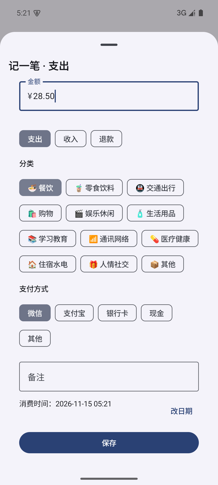
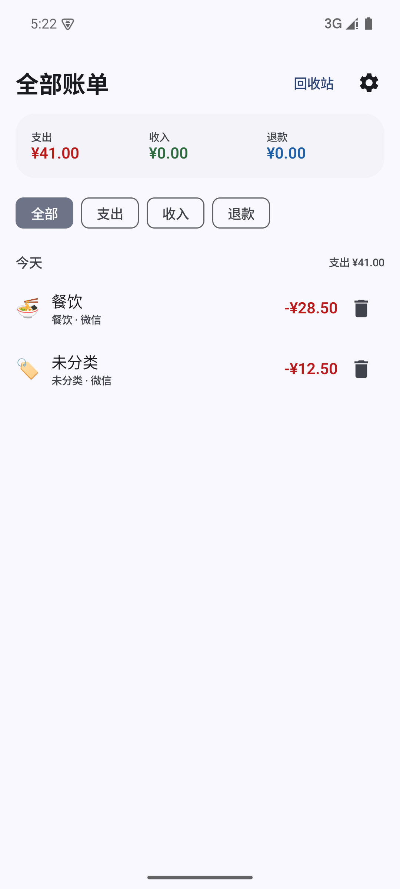
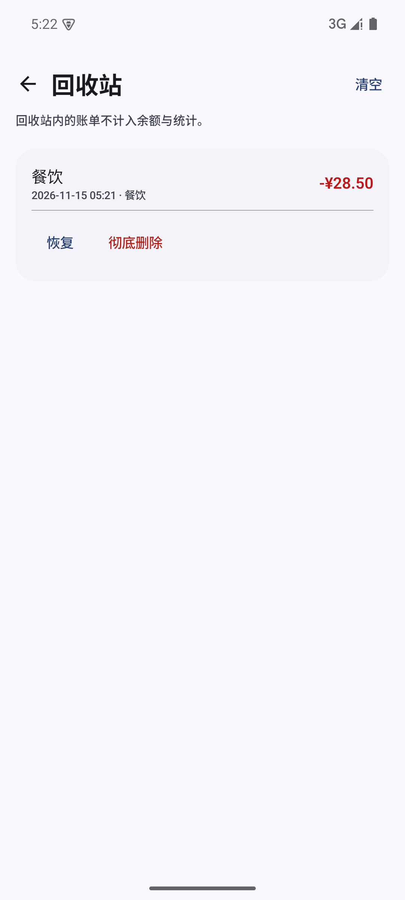

# ikuyo 记账（ikuyo Finance）

个人生活成本记账 App。Kotlin + Jetpack Compose + Material 3，MVVM + Repository，
Room 本地存储，DataStore 偏好，Coroutines + Flow。

当前版本：`0.1.0-dev`（阶段 0 工程基础 + 阶段 1 核心记账 MVP）

> 构建状态：已在 JDK 17 + Gradle 8.9 + compileSdk 35 下 `:app:assembleDebug` 编译通过，
> `:app:testDebugUnitTest` 19 项单测全绿，并在 Android 15（API 35, 1080×2400）模拟器上
> 逐屏跑通核心流程（见文末「九、验证记录」）。

截图（真机运行截图，位于 `docs/screenshots/`）：

| 首页 | 记账弹窗 | 账单列表 | 回收站 |
| --- | --- | --- | --- |
|  |  |  |  |

---

## 一、环境要求

| 项目 | 版本 |
| --- | --- |
| JDK | 17（AGP 8.7.3 要求） |
| Android Studio | Ladybug 2024.2.1 或更新 |
| Gradle | 8.9（见 `gradle/wrapper/gradle-wrapper.properties`） |
| AGP | 8.7.3 |
| Kotlin | 2.0.21（含 Compose 编译器插件） |
| KSP | 2.0.21-1.0.28 |
| compileSdk / targetSdk | 35 |
| minSdk | 26（Android 8.0） |

## 二、如何打开与构建

1. Android Studio → **Open** → 选择本目录 `ikuyo-finance`。
2. 首次同步会下载依赖，需要网络。
3. 直接运行 `app` 配置即可；debug 包名是 `xyz.ikuyo.finance.debug`。

`gradlew` / `gradlew.bat` / `gradle/wrapper/gradle-wrapper.jar` 已随仓库提供，无需再生成。
命令行构建（Windows PowerShell，JDK 17 必须在 `JAVA_HOME` 中；AGP 8.7.3 不接受 JDK 21+）：

```powershell
$env:JAVA_HOME = "C:\Program Files\Java\jdk-17"   # 换成自己的 JDK 17 路径
$env:ANDROID_HOME = "D:\android-sdk"               # 或写在 local.properties 的 sdk.dir

.\gradlew.bat :app:assembleDebug      # 打 debug APK → app/build/outputs/apk/debug/app-debug.apk
.\gradlew.bat :app:testDebugUnitTest  # 跑单元测试
.\gradlew.bat installDebug            # 装到已连接设备/模拟器
```

`local.properties` 不入库，Android Studio 首次打开会自动写入 `sdk.dir`。

## 三、已实现功能（阶段 0 + 1）

### 首页

- 总余额大卡片：**总余额 = 可用余额 + 储蓄余额**（储蓄余额当前为 0，字段与公式已就位，阶段 5 接储蓄账户）。
- 快捷记账：记支出 / 记收入 / 记退款，底部弹窗表单（金额、分类、支付方式、备注、日期）。
- 统计块：今日 / 本周 / 本月支出、本月收入、本月净收支、与上月同期对比百分比、分类 TOP3、近 7 天趋势柱。
- 预算概览：本月总预算进度条、已用 / 剩余（超支显示超支额）、每日可用。
- 最近账单：最近 5 条，可跳转全部账单。

### 账单列表

- 按消费日期倒序分组，组头显示日期 + 当日支出 / 收入。
- 类型筛选：全部 / 支出 / 收入 / 退款。
- 排序切换：按消费时间 / 按录入时间。
- 顶部汇总：支出 / 收入 / 退款三项合计。
- 单条删除（移入回收站），支持 Snackbar 撤销。

### 回收站

- 账单软删除后进入回收站，**不计入余额与统计**。
- 单条恢复、单条彻底删除、清空回收站（带确认）。

### 预算

- 本月总预算设置 / 修改 / 清除（留空 = 清除）。
- 单分类预算设置 / 修改 / 清除，逐分类显示已用与进度。
- 每日可用 = 剩余预算 ÷ 剩余天数（含今日），超支时为 0。

### 分类管理

- 12 个默认分类随数据库首次创建写入：餐饮、零食饮料、交通出行、购物、娱乐休闲、生活用品、学习教育、通讯网络、医疗健康、住宿水电、人情社交、其他。
- 默认分类可重命名、**不可删除**；自定义分类可新增 / 重命名 / 删除。

### 我的

- 数据入口：全部账单、回收站（含数量）。
- 预算管理、分类管理入口。
- 外观：跟随系统 / 浅色 / 深色（DataStore 持久化，动态取色在 Android 12+ 生效）。
- 关于：版本、数据本机存储、金额精度说明。

### AI 记账（占位）

底栏中间 tab 已按需求固定存在，页面为阶段 3 的占位说明：将支持「午饭 28 微信」这类
自然语言记账、多币种汇率折算、截图 / 小票识别**只生成草稿**。
明确写入产品约束：**AI 只产出草稿，永远不直接修改余额与预算。**

## 四、目录结构

```
app/src/main/java/xyz/ikuyo/finance/
├── core/                 Money（金额）、Time（时间窗口）、UiEvent
├── data/
│   ├── local/            Room：entity / dao / IkuyoDatabase / Migrations
│   ├── mapper/           Entity ↔ Domain
│   └── repository/       Bill / Category / Budget / Settings
├── di/Graph.kt           手写依赖容器（阶段 0 不引 Hilt）
├── domain/
│   ├── model/            Bill、Category、Budget、BillDraft、Summary 等纯模型
│   └── usecase/          AddBillUseCase、FinanceCalculator（纯函数计算）
├── feature/              home / bills / trash / budget / categories / ai / mine
├── ui/                   Routes、IkuyoApp（导航 + 底栏）、components、theme
├── IkuyoApplication.kt
└── MainActivity.kt
```

## 五、关键设计决策

### 1. 金额：整数「分」，不出现 Float / Double

- 所有金额以 `Long` 的**最小货币单位**存储与传递（人民币 = 分）。
- 汇率用 `BigDecimal` 缩放成定点整数 `exchangeRateScaled`（`RATE_SCALE = 1_000_000`，即 1e-6 精度）。
- 只有「与上月对比百分比」这类展示用的比例才出现 `Double`，且不参与任何金额结算。
- 格式化在 `core/Money.kt`：`format` / `formatSigned` / `parseToMinor`，`DecimalFormat` 固定 `Locale.US`，货币小数位按币种判定（JPY 为 0 位）。

### 2. 退款是「抵扣」，不是收入

- `BillType.REFUND` 的 `signedImpactMinor` 为正（余额回补），但 `expenseImpactMinor` 为**负**。
- 统计口径：支出统计 = `EXPENSE - REFUND`，收入统计只看 `INCOME`。
- 因此「本月支出 300、退款 120」显示支出 180，「本月收入」仍为 0，净收支为 -180。

### 3. 汇率快照

- 账单同时保存 `currency`、`exchangeRateScaled`、`cnyAmountMinor`。
- 录入当时就折算成人民币落库，历史账单**不随汇率变化而重算**。

### 4. 幂等写入（clientKey）

- 每张账单带唯一 `clientKey`（UUID），Room 上建 unique index，插入用 `INSERT OR IGNORE`。
- 重复提交（连点、重试、将来 AI 重试）不会产生两张账单；插入返回 -1 时明确提示「账单已存在，未重复写入」。

### 5. 软删除与撤销

- 删除只置 `deleted = 1` + `deletedAt`，所有统计 / 余额查询都过滤 `deleted = 0`。
- 撤销 = `restore`，彻底删除才 `purge`，因此撤销后金额与统计口径一致。
- 撤销记录只保留「最近一次」插入 / 删除的 id，符合 MVP 的 Snackbar 撤销语义。

### 6. 预算按自然月

- `BudgetRepository` 统一用 `Time.startOfMonth` / `Time.endOfMonthInclusive` 生成区间，预算区间与账期对齐。
- 总预算 `scope = TOTAL`，分类预算 `scope = CATEGORY`，两者独立存储。

### 7. 迁移与数据安全

- `data/local/Migrations.kt` 提供迁移数组模板，**禁止** `fallbackToDestructiveMigration`。
- `allowBackup = false`，`data_extraction_rules.xml` 排除全部域，避免账本被云端备份带走。

## 六、测试

纯 Kotlin JVM 单测（无需设备），共 19 项，当前全部通过：

- `MoneyTest`（9 项）：格式化、解析（含 `¥28.50`、`1,200`、`28.50.`、`1.2.3`、全角句点、非法输入）、跨币种折算、汇率定点往返。
- `FinanceCalculatorTest`（10 项）：余额公式、退款抵扣、今日 / 本周 / 本月窗口、环比、7 天趋势、预算剩余与每日可用、超支、分类净支出。

```powershell
.\gradlew.bat :app:testDebugUnitTest
```

计算逻辑全部收敛在 `domain/usecase/FinanceCalculator.kt` 的纯函数里，就是为了能这样直接测。

## 七、尚未实现（后续阶段）

- **阶段 2**：预算周期自定义、预算提醒、超支预警。
- **阶段 3**：AI 接入（OpenAI 兼容 API、Keystore 加密存 Key、自然语言 / 截图生成草稿、草稿确认后写库）。
- **阶段 4**：统计页（多维图表、时间范围自定义、分类趋势）。
- **阶段 5**：高级财务（储蓄账户与储蓄余额、债务本金、分期仅在实付时计入）。
- **阶段 6**：数据管理（导入导出、备份恢复）、发布（签名、混淆、上架）。

## 八、已知限制

- **储蓄余额恒为 0**：`BalanceSummary.savingsMinor` 与「总余额 = 可用余额 + 储蓄余额」公式已就位，
  但还没有储蓄账户的录入入口，等阶段 5 的账户模型。
- 语音记账在首页以按钮形式标注为后续能力，未接语音识别。
- AI 未接入，`AI 记账` tab 为阶段 3 的占位说明页。
- 无导入 / 导出 / 备份还原（阶段 6）；`allowBackup = false`，卸载即丢数据。
- 真机验证只在 API 35 模拟器（1080×2400）上做过，未在低版本设备、异形屏、折叠屏上回归。
- 撤销只保留「最近一次」记账 / 删除，符合 MVP 的 Snackbar 语义，不是历史多级撤销。

## 九、验证记录

1. 编译：`.\gradlew.bat :app:assembleDebug` → `BUILD SUCCESSFUL`，产出 `app/build/outputs/apk/debug/app-debug.apk`。
2. 单测：`.\gradlew.bat :app:testDebugUnitTest` → `MoneyTest` 9 项 + `FinanceCalculatorTest` 10 项，0 失败。
3. 设备：模拟器 `iku35`（Android 15 / API 35 / 1080×2400），debug 包 `xyz.ikuyo.finance.debug` 安装启动无崩溃。
4. 逐屏走查：首页余额与统计、快捷记账弹窗、账单列表分组与筛选、回收站「删除→恢复」一致性、
   总预算与分类预算（含进度条与每日可用）、分类管理新增自定义分类、AI 占位页、我的页与主题切换、收入、退款、撤销。
5. **真机走查抓到的 bug 并已修复**：金额输入框出现 `28.50.` 这类多余小数点时
   （`BigDecimal("28.50.")` 抛 `NumberFormatException`）会提示「请输入有效金额」而无法保存。
   修复：`core/Money.kt` 增加 `normalizeNumeric`（去千分位与货币符号、全角句点归一、截断第二个小数点、
   去掉结尾小数点），`ui/components/BillEntryForm.kt` 增加 `sanitizeAmountInput` 在输入阶段就过滤，
   并补了对应单测用例。